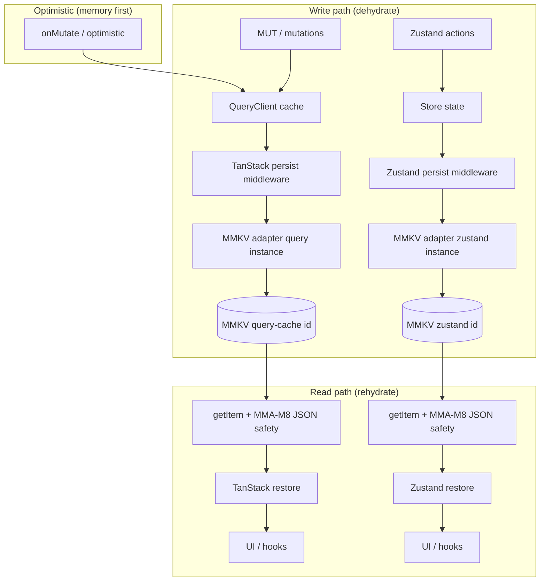

# MMKV (kit hub)

```kit-cover
type: routing
part-of: self
binds: nothing
open-when: never-by-default
skip-when: none
owns: none
```

**Keywords:** persist, MMKV, storage, rehydration, React Native

Planning: [Agent planning procedure](../agent-planning/agent-planning-procedure.md) — P1–P8 when this topic is in scope (P8 verification when implementation-bound); cite in deliverables per [markdown-authoring **M16**](../authoring/markdown-authoring.md).

English SSOT for `react-native-mmkv` when an application selects it as synchronous persistence backing for TanStack Query or Zustand (through an async adapter).

This file is not normative.

## Agent TL;DR

- When MMKV is selected: use a supported v4+ API (**MMK-G1**), separate instances or key-prefixed namespaces per domain (**MMI-M7**), and an async adapter with JSON safety (**MMA-M8**). TanStack persist `maxAge` must align with the finite project upper bound selected under UIP-M11; a family's policy may be shorter or memory-only. Apply a buster on shape or persistence-policy changes, including changes that make an older blob ineligible (MMR-M3 and related MMR rules). A PII/financial family is memory-only when the MMKV instance lacks an approved at-rest protection boundary (**MMR-M10**/**N3**); a retired dedicated sensitive instance needs file-level physical-removal proof plus bounded mount/foreground retry (**MMR-M11**/**N4**). When at-rest encryption is introduced, one fail-closed key authority, a one-mode-per-store-identity invariant and a copy → prove → delete → prove-empty migration are mandatory — and encryption alone is not a permit to persist a memory-only family (**MMR-M12**/**N5**, in [mmkv-encrypted-instance-design.md](mmkv-encrypted-instance-design.md)).
- Every storage failure path that degrades to a default (`null` read, no-op write, empty rehydrate) must report through one client failure boundary (**MMA-M5**, [**COB-RN-M11**](../client-observability-rn/silent-failure-paths.md) / [**COB-RN-M12**](../client-observability-rn/absorbed-defaults-and-global-nets.md)). A local-only log does not provide an observable failure signal when it is not delivered off-device.
- Decision gates: GMM1–GMM5 (in mmkv.md).

---

## Reading order

1. [mmkv.md](mmkv.md) — Core: **MMK-C**\*, **MMK-G**\*, **MMK-N**\*, conditional version gate, Decision gates (GMM1–GMM5), rule-prefix map.
2. [mmkv-instance-and-lazy-init.md](mmkv-instance-and-lazy-init.md) — Instance IDs, domain isolation, key namespace (**MMI-M7**), optional bootstrap retry (**MMI-M8** / **MMI-N3**), lazy `createMMKV` (MMI-\*).
3. [mmkv-async-adapter.md](mmkv-async-adapter.md) — Async `getItem` / `setItem` / `removeItem`, single failure-report boundary (**MMA-M5**), serialization safety (**MMA-M8** / **MMA-N2**).
4. [mmkv-retention-limits-and-buster.md](mmkv-retention-limits-and-buster.md) — capacity, alignment with the finite project TanStack persist maxAge upper bound (**UIP-M11**; family policy may be shorter or memory-only), buster on shape/policy change, orchestrator boundary, and persist classification gate (**MMR-M1**–**M7**, **M9**, **M10**, **N1**–**N3**).
5. [mmkv-cleanup-and-teardown.md](mmkv-cleanup-and-teardown.md) — Session teardown coverage and its single authority, identity-change and sign-in retirement verdicts, dedicated legacy-sensitive instance removal with proof of absence (**MMR-M8**, **M11**, **M13**, **N4**, **N6**, **N7**).
6. [mmkv-encrypted-instance-design.md](mmkv-encrypted-instance-design.md) — At-rest encryption design: one fail-closed key authority, one-mode-per-store-identity, copy -> prove -> delete -> prove-empty migration, and why encryption is neither a persist permit nor a persist prerequisite (**MMR-M12**, **MMR-N5**).

Code samples (non-normative): [`../_meta/examples/mmkv-code-samples.md`](../_meta/examples/mmkv-code-samples.md).

---

## Related standards

- [TanStack Query — UI / persist](../tanstack-query/ui-persist-offline.md)
- [Zustand — persist](../zustand/store-persist-and-module.md)
- [Logging policy](../logging-policy/logging-policy.md)
- [Decision matrix](../decision-matrix/decision-matrix.md)
- [Security — secrets and logging](../security/security-secrets-and-logging.md) — secrets (not MMKV)

---

## Architecture sketch (non-normative)

Optional MMKV-backed TanStack Query and Zustand persist/restore path (choose only when the project selects MMKV; IDs are normative in linked files).



**MMI-M7** : separate instances (`MMQ` vs `MMZ` ) or mandatory key prefixes if shared .

---

## Legacy source

Older local MMKV guidance is historical; use this folder as the current source.
